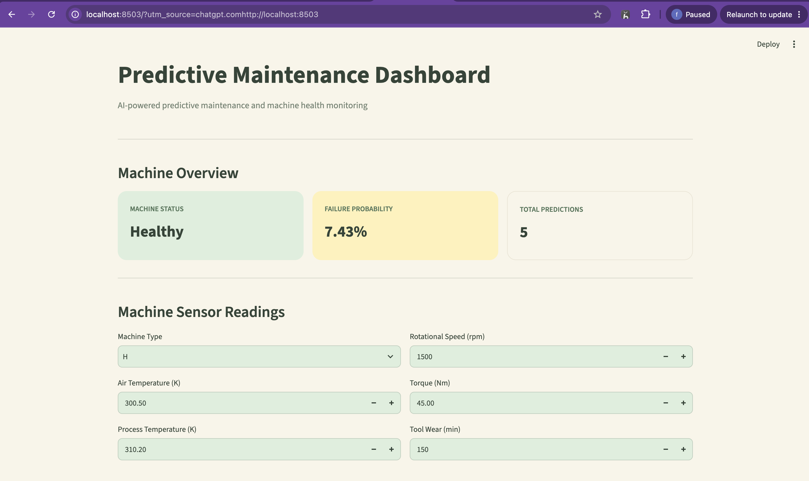
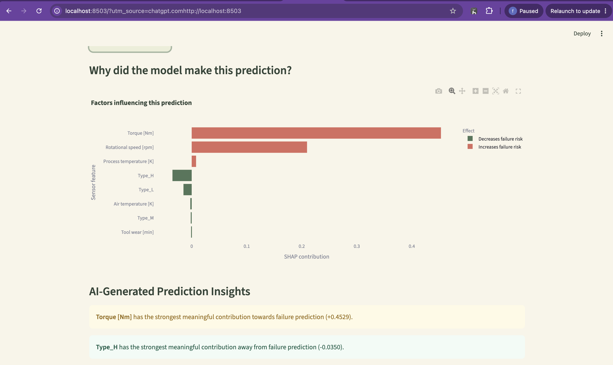
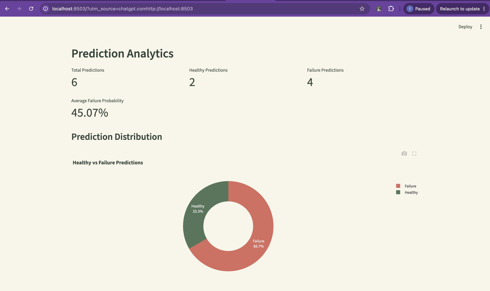

# Predictive Maintenance & Machine Failure Prediction

An end-to-end Machine Learning application that predicts industrial machine failures using operational sensor data. The project combines a Random Forest classification model, SHAP explainability, FastAPI, Streamlit, and Docker to deliver an interactive predictive maintenance system.

## Project Overview

Unexpected machine failures can lead to production downtime, maintenance costs, and operational inefficiencies.

This project aims to predict potential machine failures based on sensor measurements such as:

- Air temperature
- Process temperature
- Rotational speed
- Torque
- Tool wear
- Machine type

A machine learning model analyzes these operational parameters and estimates the probability of machine failure. SHAP (SHapley Additive exPlanations) is integrated to explain how individual features influence each prediction.

## Key Features

- **Machine Failure Prediction:** Random Forest classifier trained on industrial sensor data.
- **Threshold Optimization:** Classification threshold selected using validation data with a minimum recall requirement.
- **Model Explainability:** SHAP-based explanations showing which features increase or decrease predicted failure risk.
- **REST API:** FastAPI backend for real-time model predictions.
- **Interactive Dashboard:** Streamlit frontend for sensor input, predictions, analytics, and prediction history.
- **Data Visualization:** Interactive charts for sensor analytics and model explanations.
- **Containerization:** Docker and Docker Compose for running the API and dashboard together.

## Project Objectives

1. Build a machine learning model to identify potential machine failures.
2. Handle class imbalance and evaluate the model using appropriate classification metrics.
3. Optimize the classification threshold using validation data.
4. Explain model predictions using SHAP.
5. Develop an API and interactive dashboard for model inference.
6. Containerize the complete application using Docker.

## Dataset

This project uses the **AI4I 2020 Predictive Maintenance Dataset**, containing 10,000 records of simulated industrial machine operations.

### Dataset Details

| Attribute | Value |
|---|---:|
| Total records | 10,000 |
| Healthy machines | 9,661 |
| Machine failures | 339 |
| Target variable | Machine failure |
| Failure rate | 3.39% |

The dataset contains a significant class imbalance, with substantially fewer failure cases than healthy observations.

### Input Features

The following operational features are used for prediction:

| Feature | Description |
|---|---|
| Type | Machine quality variant |
| Air temperature [K] | Ambient air temperature |
| Process temperature [K] | Machine process temperature |
| Rotational speed [rpm] | Rotational speed |
| Torque [Nm] | Applied torque |
| Tool wear [min] | Tool usage duration |

The failure-mode indicator columns (`TWF`, `HDF`, `PWF`, `OSF`, and `RNF`) and identifier columns were excluded to prevent target leakage and avoid using non-predictive identifiers.

## Machine Learning Workflow

### 1. Data Preprocessing

- Inspected dataset structure, feature distributions, and class imbalance.
- Separated input features and target variable.
- Excluded failure-mode indicators and identifier columns.
- Applied one-hot encoding to the categorical machine type feature.
- Applied StandardScaler to numerical features.
- Used a ColumnTransformer and Scikit-learn Pipeline to keep preprocessing consistent.

### 2. Train, Validation and Test Split

The dataset was divided using stratified sampling:

| Dataset | Records | Proportion |
|---|---:|---:|
| Training | 7,000 | 70% |
| Validation | 1,500 | 15% |
| Testing | 1,500 | 15% |

Stratification preserved the original class distribution across all three subsets.

### 3. Model Training and Hyperparameter Tuning

A Random Forest Classifier was selected for the machine failure classification task.

Hyperparameter optimization was performed using GridSearchCV with:

- 5-fold Stratified Cross-Validation
- 48 hyperparameter combinations
- 240 total model fits
- Average Precision as the optimization metric

The best cross-validation Average Precision score was approximately **0.7648**.

### 4. Classification Threshold Optimization

Instead of relying on the default classification threshold of 0.5, the decision threshold was selected using the validation dataset.

The objective was to maximize precision while maintaining a minimum recall of 80%.

Selected threshold: **0.2342**

Validation performance at the selected threshold:

| Metric | Score |
|---|---:|
| Precision | 65.08% |
| Recall | 80.39% |
| F1-score | 71.93% |

This approach prioritizes identifying a high proportion of potential machine failures while maintaining reasonable precision.

### 5. Final Model Evaluation

The final model was evaluated on the held-out test dataset using the selected classification threshold.

The test dataset was not used for hyperparameter tuning or threshold selection.

| Metric | Test Score |
|---|---:|
| Accuracy | 97.67% |
| Precision | 62.12% |
| Recall | 80.39% |
| F1-score | 70.09% |
| Average Precision | 77.91% |
| ROC-AUC | 96.82% |

### Confusion Matrix

| | Predicted Healthy | Predicted Failure |
|---|---:|---:|
| Actual Healthy | 1,424 | 25 |
| Actual Failure | 10 | 41 |

The model identified 41 out of 51 actual failure cases in the test dataset.

Accuracy alone is not sufficient for evaluating this imbalanced classification problem. Precision, recall, F1-score, Average Precision, and ROC-AUC provide a more comprehensive assessment.

## Model Explainability with SHAP

To improve model interpretability, SHAP (SHapley Additive exPlanations) was integrated into the prediction pipeline.

SHAP values help explain how individual input features contribute to a model prediction.

The application provides:

- Feature-level SHAP contributions for individual predictions.
- Identification of features that increase or decrease the predicted failure output.
- Visual explanations through the Streamlit dashboard.

This makes the model's predictions easier to interpret instead of presenting only a probability score.

## Application Architecture

The project follows a modular architecture consisting of a machine learning model, an API backend, and an interactive frontend.

### Components

| Component | Technology | Purpose |
|---|---|---|
| Machine Learning | Scikit-learn | Machine failure classification |
| Explainability | SHAP | Feature contribution analysis |
| Backend | FastAPI | Prediction API |
| Frontend | Streamlit | Interactive dashboard |
| Data Visualization | Plotly | Interactive charts |
| Containerization | Docker | Application packaging |
| Orchestration | Docker Compose | Running multiple services |

### Prediction Workflow

1. User enters machine sensor measurements in the Streamlit dashboard.
2. Streamlit sends the input data to the FastAPI prediction endpoint.
3. FastAPI loads the trained model and classification threshold.
4. The model generates a failure probability and classification.
5. SHAP calculates feature-level explanations.
6. The API returns the prediction and explanations.
7. Streamlit displays the results, charts, and prediction history.

## Project Structure

```
predictive-maintenance-ml/
│
├── app/
│   ├── main.py
│   ├── frontend.py
│   └── analytics.py
│
├── data/
│   └── pm.csv
│
├── models/
│   ├── predictive_maintenance_model.joblib
│   └── threshold.json
│
├── notebook/
│   └── pm.ipynb
│
├── .streamlit/
│   └── config.toml
│
├── Dockerfile
├── docker-compose.yml
├── .dockerignore
├── .gitignore
├── requirements.txt
└── README.md
```

## Installation and Setup

### Prerequisites

Make sure the following tools are installed:

- Python 3.13
- Git
- Docker Desktop
- Docker Compose

### 1. Clone the Repository

```bash
git clone https://github.com/faizaashk/predictive-maintenance-ml.git

cd predictive-maintenance-ml
```

### 2. Create a Virtual Environment

```bash
python -m venv .venv
```

Activate it:

**macOS / Linux**

```bash
source .venv/bin/activate
```

**Windows**

```bash
.venv\Scripts\activate
```

### 3. Install Dependencies

```bash
pip install -r requirements.txt
```

## Running the Application Locally

The application consists of two services: a FastAPI backend and a Streamlit frontend.

### Start the FastAPI Backend

Open a terminal and run:

```bash
python -m uvicorn app.main:app --reload
```

The API will be available at:

```text
http://localhost:8000
```

Interactive API documentation:

```text
http://localhost:8000/docs
```

### Start the Streamlit Dashboard

Open a second terminal, activate the virtual environment, and run:

```bash
python -m streamlit run app/frontend.py
```

The dashboard will be available at:

```text
http://localhost:8501
```

## Running with Docker

Docker Compose runs the FastAPI backend and Streamlit dashboard in separate containers.

### Build and Start Containers

From the project root, execute:

```bash
docker compose up -d --build
```

### Access the Application

| Service | URL |
|---|---|
| Streamlit Dashboard | http://localhost:8503 |
| FastAPI Backend | http://localhost:8000 |
| API Documentation | http://localhost:8000/docs |

### Container Management

Check running containers:

```bash
docker compose ps
```

View application logs:

```bash
docker compose logs
```

Stop the application:

```bash
docker compose down
```

## API Usage

The application exposes a prediction endpoint:

```text
POST /predict
```

The endpoint accepts machine sensor measurements and returns:

- Predicted machine status
- Failure probability
- SHAP-based feature explanations

Interactive API testing is available through FastAPI Swagger documentation at `/docs`.


## Technologies Used

| Category | Tools and Technologies |
|---|---|
| Programming Language | Python |
| Data Processing | Pandas, NumPy |
| Machine Learning | Scikit-learn |
| Model Explainability | SHAP |
| Data Visualization | Plotly |
| Backend Development | FastAPI, Uvicorn |
| Frontend Development | Streamlit |
| Model Persistence | Joblib |
| Notebook Environment | Jupyter Notebook |
| Containerization | Docker, Docker Compose |
| Version Control | Git, GitHub |

## Limitations

- The model is trained on the AI4I 2020 simulated predictive maintenance dataset, which may not fully represent real industrial operating conditions.
- The classification threshold is selected based on validation performance and reflects a particular precision-recall trade-off.
- Model predictions represent estimated failure probabilities and should not be treated as guaranteed failure outcomes.
- Further validation on real-world industrial sensor data is necessary before operational deployment.

## Future Improvements

- Evaluate additional classification algorithms such as XGBoost and LightGBM.
- Explore advanced methods for handling class imbalance.
- Perform model calibration to improve the reliability of predicted probabilities.
- Add automated model monitoring and performance tracking.
- Integrate real-time industrial sensor data streams.
- Deploy the application to a cloud platform.
- Add automated testing and continuous integration using GitHub Actions.

## Dataset Reference

**AI4I 2020 Predictive Maintenance Dataset**

UCI Machine Learning Repository.

Dataset DOI: https://doi.org/10.24432/C5HS5C

The dataset is used for educational and machine learning experimentation purposes.

## Application Screenshots

### Dashboard Overview



### Machine Failure Prediction and SHAP Explainability



### Analytics and Prediction History

